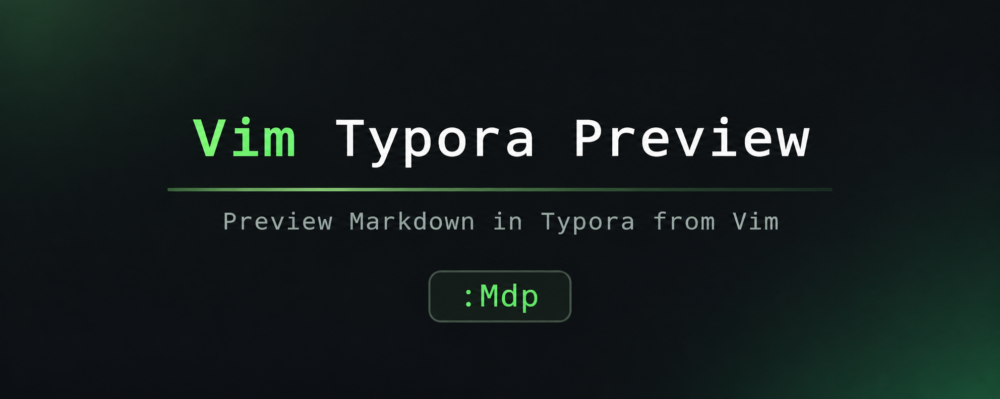

# Vim Typora Preview

**A Simple Tip for Previewing Markdown in Typora from Vim**



## Overview
Easily preview Markdown files you're editing in Vim on macOS using the familiar Typora interface. No plugins or complicated setup required. Just add one line to your `.vimrc`.

## Features

- **Simple** — Just one line in your `.vimrc`
- **No plugins required** — Uses the built-in macOS `open` command
- **No auto-save** — File saving remains under your control in Vim
- **Customizable** — Can be adapted to other apps that support Markdown

## Tested Environment

- macOS 27 Golden Gate
- VIM - Vi IMproved 9.1
- Typora Version 1.0

## Installation

Add the following line to your `~/.vimrc`:

```vim
command! Mdp silent call system('open -a "Typora" ' . shellescape(expand('%:p')))
```

To apply the changes, restart Vim or run `:source ~/.vimrc`.

## Usage

https://github.com/user-attachments/assets/88cf4223-9d1e-452b-81a1-c5e3520b365a

1. Open a Markdown file in Vim.
2. Enter `:Mdp` in Vim's command-line mode.
3. Typora will open and display the current file.

**Note:** Unsaved changes in Vim will not appear in Typora. Save the file in Vim when needed.

## Customization

To use another app instead of Typora, replace `"Typora"` with the name of your preferred app.

command! **Mdp** silent call system('open -a "**Typora**" ' . shellescape(expand('%:p')))

You can also change the command name `Mdp`. However, Vim user-defined commands must begin with an uppercase letter.

## How It Works

This command uses the macOS `open -a` command to pass the current file in Vim to the specified application.

- `command! Mdp` — Defines a custom Vim command
- `silent` — Suppresses messages during execution
- `system()` — Executes an external command
- `open -a` — Opens a file with the specified application
- `expand('%:p')` — Gets the absolute path of the current file
- `shellescape()` — Safely escapes the file path for shell execution

## License

Vim Typora Preview is released under the MIT License.

Copyright © 2026 fix

## Repository

GitHub: https://github.com/fixdot/vim-typora-preview
